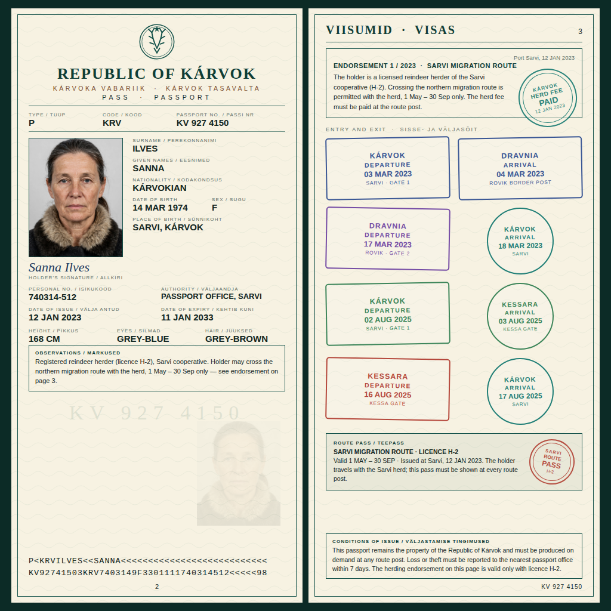

# Republic of Kárvok — Passport of Sanna Ilves

[](https://make.fun/bounty/the-passport-page-of-a-countr-2-20261121-0318)
[](https://make.fun/bounty/the-passport-page-of-a-countr-2-20261121-0318/leaderboard)
[](https://make.fun/bounty/the-passport-page-of-a-countr-2-20261121-0318)

An invented passport spread: the open passport of **Sanna Ilves**, a reindeer herder of the **Republic of Kárvok**, a subarctic tundra republic that does not exist — and the paperwork that proves she lives there.



## The country

Kárvok is a republic of tundra, lichen, and reindeer. Its capital is Sarvi, its language marks its documents in two tongues (Kárvoka Vabariik · Kárvok Tasavalta), and its emblem is a pair of antlers under a star. The passport's colour is deep teal on cream paper.

## The holder

**Sanna Ilves**, born 14 March 1974 in Sarvi, Kárvok. A registered reindeer herder of the Sarvi cooperative (licence H-2), grey-blue eyes, 168 cm, weathered by fifty winters on the migration route. Her portrait is a real photographic passport photo: fur-trimmed coat, neutral background, facing the camera.

## The telling detail

Kárvok does not stamp tourists. It stamps herders. The visas page carries:

- **Endorsement 1 / 2023 — Sarvi Migration Route**: the holder may cross the northern migration route with the herd, 1 May – 30 Sep only.
- A circular **HERD FEE PAID** stamp, dated the day the passport was issued.
- A **Route Pass** (licence H-2) that must be shown at every route post.
- Eight entry and exit stamps in chronological order — Kárvok ↔ Dravnia (March 2023) and Kárvok ↔ Kessara (August 2025) — every stamp after the passport's issue date of 12 January 2023, none before it, all before its expiry on 11 January 2033.

## Internal consistency

- Passport No. **KV 927 4150**, Personal No. 740314-512, issued 12 JAN 2023, expires 11 JAN 2033, authority: Passport Office, Sarvi.
- The machine-readable zone (MRZ) at the bottom of the data page is a valid ICAO TD3 MRZ: both lines are 44 characters and every check digit (document number, date of birth, date of expiry, personal number, composite) is correct.
- The ghost portrait watermark and the faint passport number repeat on the data page, as on a real passport.

## How this entry works

`main.ts` (Node 22, standard library only, no network) reads `entry.png`, validates that it is a PNG of exactly 1024×1024 pixels and at most 1 MiB, and copies it to `$MAKEFUN_OUTPUT_DIR` (default `/output`) as `entry.png`.

```sh
node main.ts
# entry.png 1024x1024 337495 bytes -> /output/entry.png
```

## Files

- `entry.png` — the passport spread, 1024×1024 PNG.
- `main.ts` — the program that writes the image to the output directory.
- `LICENSE` — MIT.

## License

MIT — see [LICENSE](LICENSE).
